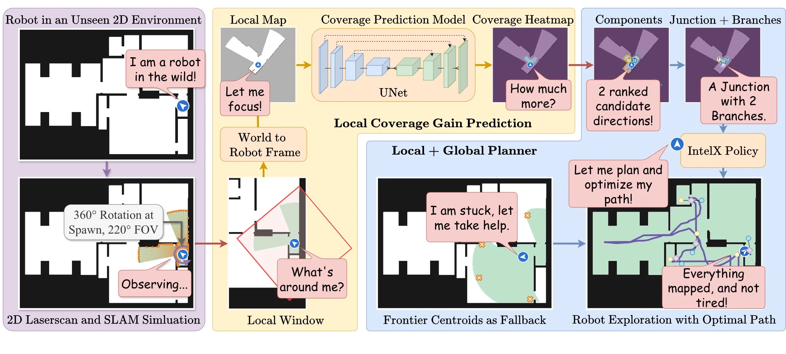
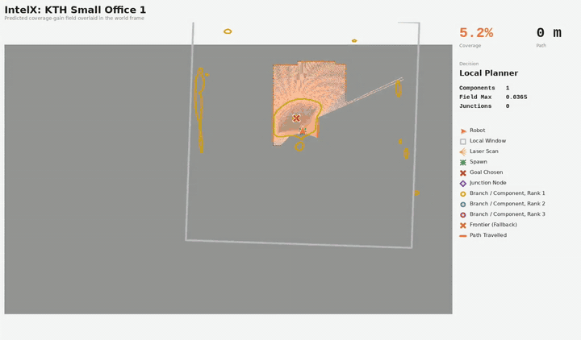

<div align="center">

<h1>

</h1>

### IntelX: Autonomous Indoor Exploration via Local Coverage Gain Prediction<br>and Structure-Aware Planning

<a href="https://sauravdosi.com/">Saurav Dosi</a><sup>1,2</sup> &nbsp;·&nbsp;
<a href="https://www.linkedin.com/in/itay-kadosh/">Itay Kadosh</a><sup>3</sup> &nbsp;·&nbsp;
<a href="https://yuxng.github.io/">Yu Xiang</a><sup>1</sup>

<sup>1</sup>UT Dallas &nbsp;&nbsp; <sup>2</sup>Weill Cornell Medicine &nbsp;&nbsp; <sup>3</sup>UF

<br>

<a href="https://irvlutd.github.io/IntelX/"></a>
<a href="https://irvlutd.github.io/IntelX/#demo"></a>
<a href="https://irvlutd.github.io/IntelX/#video"></a>
<a href="https://utdallas.box.com/s/stgu95mdcf3p7tgp5z5a53pcxiuwrplu"></a>

<a href="https://github.com/IRVLUTD/IntelX/actions/workflows/tests.yml"></a>
<a href="LICENSE"></a>

<br>



<sub>From the robot's scan and local window to the predicted coverage gain, its candidate directions and junctions, and the explored floor.</sub>

</div>

<br>

IntelX explores unseen indoor spaces with one lightweight U-Net. The network
regresses, over a robot-frame occupancy image, how much new area the sensor
would gain from each nearby goal. The planner reads angular components of that
field as candidate directions, reads multi-peaked structure as a junction, and
commits to branches weakest first. This repository holds the simulator, the
coverage-gain regressor, the policy, and every baseline the paper compares
against.

<div align="center">



<sub>IntelX exploring KTH Small Office 1, from the supplementary video. Run it on a floor plan of your own in the <a href="https://irvlutd.github.io/IntelX/#demo">live demo</a>.</sub>

<br>

[Citation](#citation) &nbsp;·&nbsp;
[Getting Started](#getting-started) &nbsp;·&nbsp;
[Methods](#methods) &nbsp;·&nbsp;
[Repository Layout](#repository-layout) &nbsp;·&nbsp;
[Documentation](#documentation)

</div>

## Citation

```bibtex
@misc{dosi2026intelx,
  title  = {IntelX: Autonomous Indoor Exploration via Local Coverage Gain
            Prediction and Structure-Aware Planning},
  author = {Dosi, Saurav and Kadosh, Itay and Xiang, Yu},
  year   = {2026},
  note   = {Code: \url{https://github.com/IRVLUTD/IntelX}}
}
```

## Getting Started

Python 3.11 and an NVIDIA GPU: the simulator casts its rays in numba CUDA
kernels.

```bash
git clone https://github.com/IRVLUTD/IntelX.git
cd IntelX
python3.11 -m venv .venv
. .venv/bin/activate
pip install -r requirements.txt
pip install -e .
```

`requirements.txt` takes torch 2.11 in its CUDA 12.8 build, for GPUs from
Turing to Blackwell; [docs/running.md](docs/running.md#install) covers older
GPUs. Put the trained checkpoint,
[`checkpoint_best.pth`](https://utdallas.box.com/s/2tuurbusuawkowwe9rjnmsbkhtgm6b5o)
(293.4 MB, its checksum in [`weights/README.md`](weights/README.md)), in
`weights/`, then:

```bash
python -m intelx.cli.run_intelx                    # IntelX on Small Office 3, drawn live
python -m intelx.cli.run_method --method nearest --map ood/aws_maps/hospital.pgm
python -m intelx.cli.run_sweep_all --selftest      # the benchmark's self-test, no GPU
```

Three maps ship with the repository, one of each kind. The
[Box folder](https://utdallas.box.com/s/stgu95mdcf3p7tgp5z5a53pcxiuwrplu) holds
every test, out-of-distribution and real map; the contents of its `maps/`
folder go in `data/maps/`. The 18 training maps and the coverage dataset (about
1 TB) are not public yet; `collect_data` regenerates the dataset from the
training maps.

## Methods

Every method runs in the same simulator, on the same maps and from the same
spawns.

| Key | Method | Notes |
|:--|:--|:--|
| `ours` | IntelX | the coverage-gain field, the local and the global planner |
| `local_only` | IntelX, Local Only | the ablation without the global planner |
| `random` `nearest` `cost_utility` `geom_ig` | Random Frontier, Nearest Frontier, Cost-Utility, Geometric IG | geometry only |
| `frontier` | Frontier (AutoX) | the deployed reference |
| `mapex` `upen` `hectoraug` | MapEx, UPEN, IG-Hector | need [MapEx](https://github.com/castacks/MapEx), linked at `third_party/MapEx`, and its [service](services/README.md) |

<sub>[docs/benchmark.md](docs/benchmark.md) has each method's goal rule, the
paired protocol, `SUBMITTED_BEHAVIOUR` and the two sensing regimes.</sub>

## Repository Layout

| Folder | Contents |
|:--|:--|
| [`src/intelx/`](docs/code.md) | the simulator, the regressor, the policy and the baselines |
| [`docs/`](docs) | training, running, the benchmark and a map of the code |
| [`data/`](data/README.md) | the maps and the root of the coverage dataset |
| [`weights/`](weights/README.md) | the trained checkpoint |
| [`services/`](services/README.md) | the bridge to MapEx for the prediction baselines |
| `third_party/MapEx/` | MapEx, a git submodule |
| `tests/` | layout, path and hygiene checks, which need only pytest |
| `scripts/` | checkpoint tools |

## Documentation

- [Training the Regressor](docs/training.md): data collection, training and evaluation
- [Running IntelX](docs/running.md): installing, one episode, any single method, settings and paths
- [The Benchmark](docs/benchmark.md): the sweep, the baselines and how they are run
- [Code Map](docs/code.md): the layout, every module and the tests
- [Maps and Data](data/README.md), [Checkpoint](weights/README.md), [MapEx Service](services/README.md)

---

<div align="center">
<sub>
Code under the <a href="LICENSE">MIT License</a>. <code>rrt.py</code> and <code>rrt_star.py</code> are adapted from
<a href="https://github.com/AtsushiSakai/PythonRobotics">PythonRobotics</a>, MIT licensed, with its notice in each file.
Questions: <a href="https://github.com/IRVLUTD/IntelX/issues">open an issue</a> or contact
<a href="https://sauravdosi.com/">Saurav</a> or
<a href="https://www.linkedin.com/in/itay-kadosh/">Itay</a>.
<br>
Built at the <a href="https://labs.utdallas.edu/irvl/">Intelligent Robotics and Vision Lab</a>,
The University of Texas at Dallas.
</sub>
</div>
