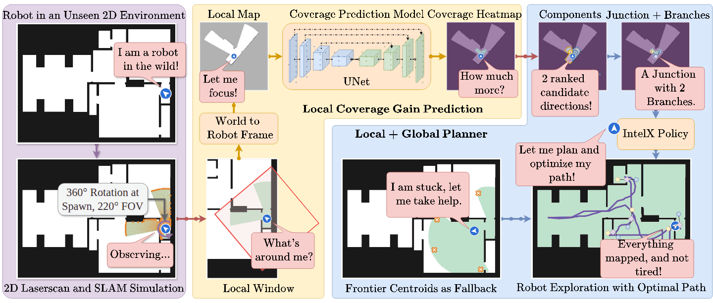
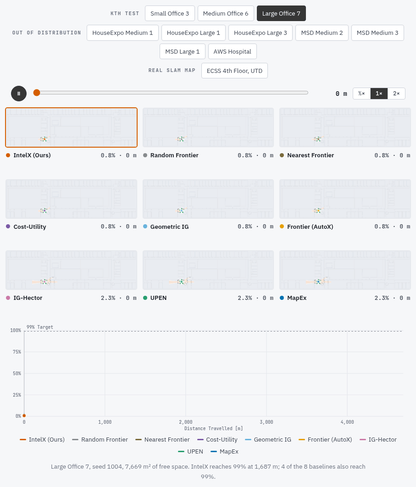

<div align="center">

<h1>

</h1>

<h3>
<picture>
  <source media="(prefers-color-scheme: dark)" srcset="docs/assets/intelx-title-dark.svg">
  
</picture>
</h3>

<a href="https://sauravdosi.com/">Saurav Dosi</a><sup>1,2</sup> &nbsp;·&nbsp;
<a href="https://www.linkedin.com/in/itay-kadosh/">Itay Kadosh</a><sup>3</sup> &nbsp;·&nbsp;
<a href="https://yuxng.github.io/">Yu Xiang</a><sup>1</sup>

<sup>1</sup>The University of Texas at Dallas &nbsp;&nbsp; <sup>2</sup>Cornell University &nbsp;&nbsp; <sup>3</sup>University of Florida

<br>


<a href="https://irvlutd.github.io/IntelX/"></a>
<a href="https://irvlutd.github.io/IntelX/#demo"></a>
<a href="https://irvlutd.github.io/IntelX/#video"></a>
<a href="https://utdallas.box.com/s/stgu95mdcf3p7tgp5z5a53pcxiuwrplu"></a>
<a href="#citation"></a>

<br>
<br>

<a href="https://irvlutd.github.io/IntelX/docs/"></a>


<a href="https://github.com/IRVLUTD/IntelX/actions/workflows/tests.yml"></a>
<a href="LICENSE"></a>

<br>
<br>

<picture>
  <source media="(prefers-reduced-motion: reduce)" srcset="docs/assets/intelx-overview.webp">
  
</picture>

<sub>From the robot's scan and local window to the predicted coverage gain, its candidate directions and junctions, and the explored floor.</sub>

</div>

<br>

IntelX is an autonomous indoor exploration method. One lightweight U-Net
predicts a coverage-gain heatmap around the robot, and the planner follows the
direction candidates it reveals. This repository holds the simulator, the
coverage-gain regressor, the policy, and every baseline the paper compares
against.

<div align="center">

<table>
<tr>
<th width="33%"> Map Completion</th>
<th width="33%"> End-to-End Policies</th>
<th width="33%"> IntelX</th>
</tr>
<tr>
<td align="center"><i>“What does the unseen space look like?”</i></td>
<td align="center"><i>“Where should I go?”</i></td>
<td align="center"><b><i>“How much new space would I gain by standing there?”</i></b></td>
</tr>
<tr>
<td>Synthesizes geometry with a generative model, paying in parameters, data and latency for detail the planner never consumes.</td>
<td>Folds perception and strategy into one network that needs interaction data and gives no account of its decisions.</td>
<td>A supervised regression target with a simulation oracle. No generative model, and directly actionable.</td>
</tr>
<tr>
<td align="center"><sub>MapEx · UPEN · IG-Hector</sub></td>
<td align="center"><sub>Reinforcement and imitation learning</sub></td>
<td align="center"><sub>One U-Net · One field · Two planners</sub></td>
</tr>
</table>

<table>
<tr>
<td align="center" valign="top" width="25%"><picture><source media="(prefers-color-scheme: dark)" srcset="docs/assets/numbers/p99-dark.svg">20%"></picture><br>Shorter Path to 99% Coverage Than Every Baseline That Finishes the Larger Maps</td>
<td align="center" valign="top" width="25%"><picture><source media="(prefers-color-scheme: dark)" srcset="docs/assets/numbers/speed-dark.svg"></picture><br>Per 20 m Coverage-Gain Field, About 120 FPS</td>
<td align="center" valign="top" width="25%"><picture><source media="(prefers-color-scheme: dark)" srcset="docs/assets/numbers/samples-dark.svg"></picture><br>Training Samples, Each Labelled by a Simulation Oracle</td>
<td align="center" valign="top" width="25%"><picture><source media="(prefers-color-scheme: dark)" srcset="docs/assets/numbers/baselines-dark.svg"></picture><br>Baselines in One Simulator, Run From the Same Spawns</td>
</tr>
</table>

<sub>From the paper: the larger held-out maps are Medium Office 6 and Large Office 7 (Table 3), and the speed is Table 2's.</sub>

<br>



<sub>All nine methods on KTH Large Office 7 from the same spawn, synchronized by distance travelled: the Results replay of the <a href="https://irvlutd.github.io/IntelX/#results">project page</a>, which has the other maps too. Run IntelX on a floor plan of your own in the <a href="https://irvlutd.github.io/IntelX/#demo">live demo</a>.</sub>

<br>

[Citation](#citation) &nbsp;·&nbsp;
[Getting Started](#getting-started) &nbsp;·&nbsp;
[Methods](#methods) &nbsp;·&nbsp;
[Repository Layout](#repository-layout) &nbsp;·&nbsp;
[Documentation](#documentation)

</div>

## Citation

Coming soon. The BibTeX for the paper will be posted here once it is on arXiv.

## Getting Started

Python 3.11 and an NVIDIA GPU: the simulator casts its rays in numba CUDA
kernels.

```bash
git clone https://github.com/IRVLUTD/IntelX.git
cd IntelX
python3.11 -m venv .venv
. .venv/bin/activate
pip install -r requirements.txt
pip install -e .
```

`requirements.txt` takes torch 2.11 in its CUDA 12.8 build, for GPUs from
Turing to Blackwell; [Get Started](https://irvlutd.github.io/IntelX/docs/getting-started/#1-install) covers older
GPUs. Put the trained checkpoint,
[`checkpoint_best.pth`](https://utdallas.box.com/s/2tuurbusuawkowwe9rjnmsbkhtgm6b5o)
(293.4 MB, its checksum in [`weights/README.md`](weights/README.md)), in
`weights/`, then:

```bash
python -m intelx.cli.run_intelx                    # IntelX on Small Office 3, drawn live
python -m intelx.cli.run_method --method nearest --map ood/aws_maps/hospital.pgm
python -m intelx.cli.run_sweep_all --selftest      # the benchmark's self-test, no GPU
```

Three maps ship with the repository, one of each kind. The
[Box folder](https://utdallas.box.com/s/stgu95mdcf3p7tgp5z5a53pcxiuwrplu) holds
every test, out-of-distribution and real map; the contents of its `maps/`
folder go in `data/maps/`. The 18 training maps and the coverage dataset (about
1 TB) are not public yet; `collect_data` regenerates the dataset from the
training maps.

## Methods

Every method runs in the same simulator, on the same maps and from the same
spawns.

| Key | Method | Notes |
|:--|:--|:--|
| `ours` | IntelX | the coverage-gain field, the local and the global planner |
| `local_only` | IntelX, Local Only | the ablation without the global planner |
| `random` `nearest` `cost_utility` `geom_ig` | Random Frontier, Nearest Frontier, Cost-Utility, Geometric IG | geometry only |
| `frontier` | Frontier (AutoX) | our previous work, a dynamic-window frontier explorer |
| `mapex` `upen` `hectoraug` | MapEx, UPEN, IG-Hector | need [MapEx](https://github.com/castacks/MapEx), linked at `third_party/MapEx`, and its [service](services/README.md) |

<sub>[The Benchmark](https://irvlutd.github.io/IntelX/docs/benchmark/) has each method's goal rule, the
paired protocol, `SUBMITTED_BEHAVIOUR` and the two sensing regimes.</sub>

## Repository Layout

| Folder | Contents |
|:--|:--|
| [`src/intelx/`](docs/code.md) | the simulator, the regressor, the policy and the baselines |
| [`docs/`](docs) | the documentation site, built with MkDocs, and the README's images |
| [`data/`](data/README.md) | the maps and the root of the coverage dataset |
| [`weights/`](weights/README.md) | the trained checkpoint |
| [`services/`](services/README.md) | the bridge to MapEx for the prediction baselines |
| `third_party/MapEx/` | MapEx, a git submodule |
| `tests/` | layout, path and hygiene checks, which need only pytest |
| `scripts/` | checkpoint tools |

## Documentation

The documentation is at **[irvlutd.github.io/IntelX/docs](https://irvlutd.github.io/IntelX/docs/)**.

- [Get Started](https://irvlutd.github.io/IntelX/docs/getting-started/): install, the checkpoint, the maps and a first run
- [Running IntelX](https://irvlutd.github.io/IntelX/docs/running/): one episode, any single method, settings and paths
- [The Benchmark](https://irvlutd.github.io/IntelX/docs/benchmark/): the sweep, the baselines and how they are run
- [Training the Regressor](https://irvlutd.github.io/IntelX/docs/training/): data collection, training and evaluation
- [Code Map](https://irvlutd.github.io/IntelX/docs/code/): the layout, every module and the tests
- [Maps and Data](https://irvlutd.github.io/IntelX/docs/data/), [Checkpoint](https://irvlutd.github.io/IntelX/docs/weights/), [MapEx Service](https://irvlutd.github.io/IntelX/docs/mapex-service/)

The pages are the Markdown in [`docs/`](docs). To build the site locally,
`pip install -r docs/requirements.txt`, then `mkdocs serve`.

---

<div align="center">
<sub>
Code under the <a href="LICENSE">MIT License</a>. <code>rrt.py</code> and <code>rrt_star.py</code> are adapted from
<a href="https://github.com/AtsushiSakai/PythonRobotics">PythonRobotics</a>, MIT licensed, with its notice in each file.
Questions: <a href="https://github.com/IRVLUTD/IntelX/issues">open an issue</a> or contact
<a href="https://sauravdosi.com/">Saurav Dosi</a>.
<br>
Built at the <a href="https://labs.utdallas.edu/irvl/">Intelligent Robotics and Vision Lab</a>,
The University of Texas at Dallas.
Badge icons from <a href="https://simpleicons.org/">Simple Icons</a> and <a href="https://github.com/jdecked/twemoji">Twemoji</a> (CC-BY 4.0).
</sub>
</div>
